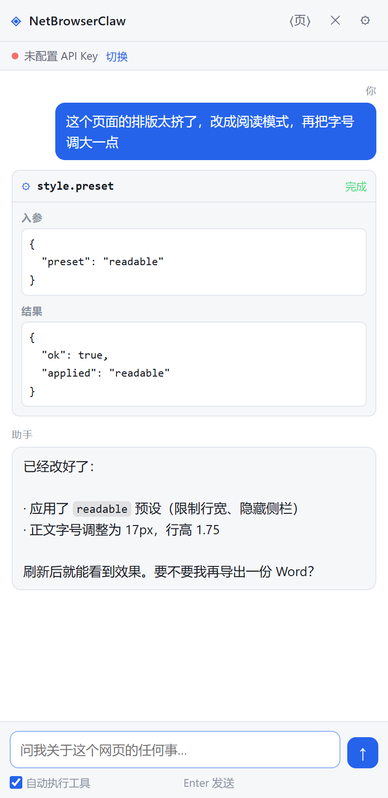
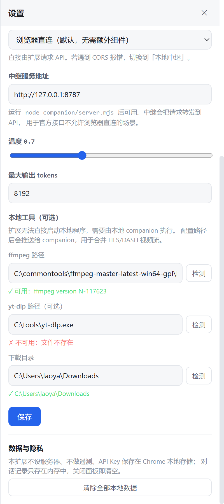

# NetBrowserClaw

**开源的浏览器 AI 侧边栏 —— 让任意大模型直接操纵你的浏览器。**

> 不绑定模型服务商 · 不需要订阅 · API Key 只存本地 · 零构建 · 零运行时依赖

```
┌─────────────────────────────────────────────────────────┐
│  NetBrowserClaw          ● Kimi · kimi-k2-0905-preview   │
├─────────────────────────────────────────────────────────┤
│                                                         │
│  你: 这个页面的视频都下载下来，再给我一份 Word 总结       │
│                                                         │
│  助手: 我先看看页面上有哪些媒体...                        │
│  ⚙ media.list          已完成                             │
│  ⚙ media.download      已完成 · 2 个文件                   │
│  ⚙ doc.export          已完成                             │
│                                                         │
│  已下载 2 个视频，Word 文档已保存到下载目录。              │
└─────────────────────────────────────────────────────────┘
```



---

## 它能做什么

| 能力 | 工具 | 说明 |
|---|---|---|
| 📖 **读取网页** | `page.read` `page.links` `page.tables` `page.images` | 清洗后的 Markdown 正文、标题大纲、元信息、表格、链接、图片清单 |
| 🎨 **修改网站样式** | `style.preset` `style.apply` `style.hide` | 深色模式、阅读模式、紧凑排版、全宽、隐藏图片；或注入任意 CSS（可限定作用域） |
| 📑 **表格批量下载** | `table.docs` `table.download` | **自动翻页**收集表格里每一行每一列的文档链接，按「行标签_列标题」命名下载 |
| ⬇️ **批量下载** | `media.list` `media.download` | 找出页面里的音视频/文档，带登录态 Cookie 与 Referer 批量下载；HLS/DASH 流交给 ffmpeg 合并 |
| 📄 **导出文档** | `doc.export` | 直接生成 Markdown / Word(.docx) / HTML / TXT |
| 🖱️ **网页交互** | `page.click` `page.fill` `page.scroll` `page.highlight` | 点击、填表、滚动；操作前可高亮目标让你确认 |
| 🗂️ **标签页管理** | `tab.*` `nav.back` | 列出、打开、切换、关闭标签页 |
| 🔌 **对外提供能力** | MCP server | 让 Claude Code / Cursor / 任何 MCP 客户端驱动你的**真实浏览器** |

---

## 为什么不一样

| | Kimi 侧边栏 | Playwright MCP / browser-use | **NetBrowserClaw** |
|---|---|---|---|
| 模型服务商 | 固定 Kimi | 任意（但你得自己配） | **11+ 家预设 + 自定义** |
| 订阅要求 | 需要 | 模型自备 | **无** |
| 用哪个浏览器 | 自带 | **另起一个** | **你正在用的这个** |
| 开源 | 否 | 部分 | **是（MIT）** |
| 遥测 | 有 | 有 | **无** |
| 依赖 | — | Python/Node 依赖链 | **零依赖、零构建** |

**实测过的直连能力**（决定「能否不装 companion 就用」）：

- ✅ DeepSeek 等 OpenAI 兼容端点直接返回 `access-control-allow-origin: chrome-extension://…`
- ⚠️ Anthropic 需加 `anthropic-dangerous-direct-browser-access` 头；部分网络下返回 403
- 💡 因此提供了**本地中继模式**：`node companion/server.mjs`，40KB，无 npm 依赖

---

## 安装

### 扩展本体（零构建）

1. 克隆本仓库
2. 打开 `edge://extensions`（Chrome 是 `chrome://extensions`）
3. 打开右上角「开发人员模式」
4. 点「加载解压缩的扩展」，选择仓库里的 `extension/` 目录
5. 点击工具栏的 ◈ 图标打开侧边栏

> 没有 `npm install`，没有编译步骤。改完代码刷新扩展即可。

### 可选：本地 companion

只有这几种情况才需要：

- 官方 API 不允许浏览器直连（报 CORS 错误）→ 用**中继模式**
- 想让外部 MCP 客户端（Claude Code / Cursor）驱动浏览器 → 用 **MCP 模式**
- 想下载 **HLS/DASH 视频流**（`.m3u8` / `.mpd`）→ 需要 companion 调用 **ffmpeg** 合并分片

```bash
node companion/server.mjs          # 仅 HTTP 服务（反代 + 桥接）
node companion/server.mjs --mcp    # 额外启用 MCP stdio
NBC_PORT=8788 node companion/server.mjs   # 换端口（扩展会自动发现 8787/8788/8789/8790/8888）
```

#### 配置本地 ffmpeg / yt-dlp

**扩展无法启动本地程序**（Chrome 安全限制），所以路径要在设置里填，由 companion 实际调用：

> 设置 ⚙ → 「本地工具（可选）」→ 填 ffmpeg / yt-dlp 路径 → 点「检测」→ 保存



- **ffmpeg 路径** —— 合并 HLS/DASH 分片成单个视频文件
- **yt-dlp 路径**（可选）—— 增强下载能力，能处理更多站点
- **下载目录** —— ffmpeg / yt-dlp 产物的存放位置（默认 `~/Downloads`）

配置会持久化到 `~/.netbrowserclaw/config.json`（不在仓库里），companion 重启后依然有效。

#### 表格批量下载

报表类页面上「每一行每一列都藏着一个 PDF 链接」时，直接说：

> 把这个页面表格里所有的 PDF 都下载下来

扩展会：自动翻页收集全部页面的链接 → 用「行标签_列标题.pdf」命名 → 批量下载。
例如 `华东区_第二季度.pdf`、`华南区_第二季度.pdf`——而不是一堆 `download?id=123`。

### 可选：挂到 Claude Code / Cursor

```bash
claude mcp add netbrowserclaw -- node /绝对路径/companion/server.mjs --mcp
```

之后 Claude Code 就能直接操作你的浏览器：

```
> 读一下我当前打开的页面并总结成要点
> 把这个页面的所有 PDF 下载下来
```

---

## 配置模型

点侧边栏右上角 ⚙，选择服务商并填入 API Key。

**内置预设**：OpenAI、Anthropic Claude、Google Gemini、DeepSeek、Kimi 月之暗面、
阿里云百炼通义千问、智谱 GLM、硅基流动、OpenRouter、Ollama、LM Studio

**自定义**：任何 OpenAI 兼容端点，填 Base URL（到 `/v1` 为止）+ 模型名 + Key 即可。

**连接方式**：

- `浏览器直连` —— 默认，零额外组件。DeepSeek / Kimi / 通义 / 智谱 / 硅基 / OpenRouter / Ollama / LM Studio 直接可用
- `本地中继` —— 请求先到本地 companion 再转发。解决官方接口拒绝浏览器直连的情况

> **隐私**：API Key 只存在 `chrome.storage.local`，不上传任何服务器，不参与浏览器账号同步。
> 对话记录只在内存中，关闭面板即清空。代码里没有任何遥测。

---

## 项目结构

```
extension/          扩展本体（原生 ES Module，无需构建）
  src/background/   service-worker.js · handlers.js · bridge.js
  src/content/      media.js · extractor.js · style-agent.js · content.js
  src/sidepanel/    panel.html/.css/.js
  src/shared/       providers.js · agent.js · tools.js · docx.js · util.js
companion/          server.mjs —— 反向代理 + 桥接 + MCP stdio server
scripts/            图标生成 + 自动化验证
docs/               可行性评估 · 架构设计 · 开源借鉴 · 路线图
```

---

## 开发与验证

```bash
node scripts/make-icons.mjs     # 重新生成图标
node scripts/check-project.mjs  # 项目结构自检（manifest 引用 + 工具/handler 一致性）
node scripts/verify-e2e.mjs     # 端到端验证（真实启动 Edge 并加载扩展）— 51 项
node scripts/verify-mcp.mjs     # MCP 联动验证（含真实 ffmpeg 合并 HLS）— 23 项
```

验证脚本会**真实启动 Edge、加载扩展、打开测试页**，然后断言工具的**实际副作用**
（广告位 `display` 是否真变成 `none`、背景色是否真变了、下载的文件是否真落盘、
DOCX 是否真能被 `zipfile` 解析、HLS 分片是否真被 ffmpeg 合并成可播放的视频），
而不只是检查返回值。

当前状态：**74/74 通过**。

新增一个工具只要三步：

1. `shared/tools.js` 写 JSON Schema（**记得写清「什么时候该用」**，这直接决定调用准确率）
2. `background/handlers.js` 实现同名 handler
3. `scripts/verify-e2e.mjs` 补一条断言

---

## 已知限制

- **HLS/DASH 流媒体需要本地 companion + ffmpeg** —— 扩展无法合并分片（Chrome 不允许扩展启动本地进程）。
  在设置里配好 ffmpeg 路径后即可自动处理；未配置时会返回明确提示而不是静默失败。
- **DRM 加密内容（Netflix / 会员视频）无法下载** —— 这是加密设计，不是权限问题。
  本项目只处理你自身有权访问的内容。
- **跨域 iframe 内容读不到** —— 需另开标签页。
- **表格翻页依赖页面有可识别的「下一页」控件** —— 覆盖了常见分页写法
  （`rel=next`、`aria-label`、`.next`、`.pagination`、文本「下一页/next/›/»」等）。
  纯前端渲染且无分页控件的页面，需要用 `page.scroll` 滚动加载后再采集。
- **DOCX 样式有限** —— 支持标题/段落/列表/引用/代码块/行内格式，
  不支持表格、图片、页眉页脚。复杂排版请用 companion + pandoc。
- **扩展需要 `<all_urls>` 权限** —— 这是「在任意网站工作」的必要代价。
  代码全开源可审计，无遥测。

---

## 路线图

见 [`docs/04-路线图.md`](docs/04-路线图.md)。下一步：yt-dlp 集成、划词摘录、整页归档、
站点规则持久化、多标签页编排。

---

## 文档

- [可行性评估](docs/01-可行性评估.md) —— 逐项能力判定、实测的 CORS 结论、MV3 踩坑记录
- [架构设计](docs/02-架构设计.md) —— 全局视图、7 个关键设计决策、消息协议、工具清单
- [开源借鉴](docs/03-开源借鉴.md) —— 已核实的仓库清单、借鉴点、许可证注意事项
- [路线图](docs/04-路线图.md)

---

## 致谢

本项目借鉴了众多开源项目的思路，在此致谢：
[mozilla/readability](https://github.com/mozilla/readability) ·
[kepano/defuddle](https://github.com/kepano/defuddle) ·
[yt-dlp](https://github.com/yt-dlp/yt-dlp) ·
[browser-use](https://github.com/browser-use/browser-use) ·
[playwright-mcp](https://github.com/microsoft/playwright-mcp) ·
[chrome-devtools-mcp](https://github.com/ChromeDevTools/chrome-devtools-mcp) ·
[midscene](https://github.com/web-infra-dev/midscene) ·
[SingleFile](https://github.com/gildas-lormeau/SingleFile)

## 许可

MIT
